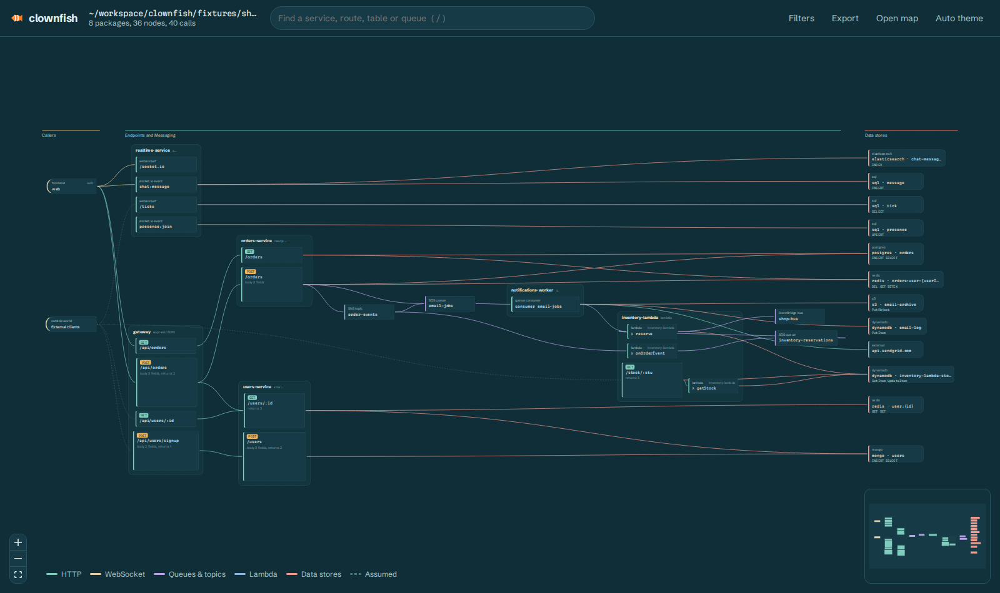
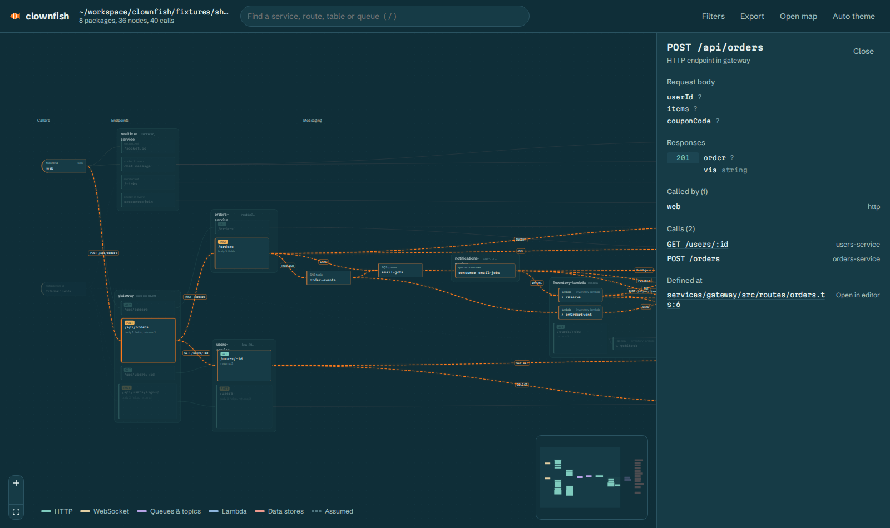

# clownfish 🐠

Point clownfish at a folder full of Node.js services, such as `~/code` on your Mac. It reads the source without running it and builds a map of **who calls whom and where each call ends up**:

```
caller (frontend, worker, cron)  →  API endpoint (service)  →  … more endpoints / queues / topics …  →  table · redis key · bucket · index
```

The scan writes **JSON or XML**. The bundled viewer renders that file as a zoomable left-to-right flow. Callers sit on the left, endpoints are grouped by service in the middle, and terminal data stores sit on the right. Each endpoint shows its request body and response metadata.



Select any node or call to trace every path through it. The detail drawer shows the request and response bodies, the SQL statements, how confident the match is, and the exact lines of code it came from.



## Quick start

Requires Node **22.18+**. It runs TypeScript directly, with no build step for the scanner.

```bash
git clone git@github.com:aquilacodes/clownfish.git && cd clownfish
npm install
npm run build:viewer            # once, builds the web viewer

./bin/clownfish.js scan ~/code -o map.json        # or -o map.xml / --format xml
./bin/clownfish.js view map.json                  # opens the viewer in your browser
./bin/clownfish.js serve --open                   # viewer + API; scan folders from the browser
```

`npm link` puts `clownfish` on your PATH.

| Command | What it does |
| --- | --- |
| `clownfish scan <dir> [-o file] [-f json\|xml] [-i glob…] [--include-tests] [--no-external-clients] [-w n] [-q]` | Scan and write the map. Output goes to stdout when there is no `-o`. |
| `clownfish serve [-p 7777] [-m map.json] [--open]` | Start the local API and viewer on `127.0.0.1`. |
| `clownfish view <map.json\|map.xml>` | Serve one map file and open it. |

## What it detects

| Area | Recognised |
| --- | --- |
| **Inbound endpoints** | Express (routers, `app.use('/prefix', router)`, `route()` chains, route modules taking `app`), Koa + `@koa/router` (with `prefix`), Fastify (`register` + prefix, `route()`), NestJS (`@Controller` / `@Get…`, `setGlobalPrefix`, `@Body()` DTOs), Hapi, Lambda handlers from `serverless.yml` and SAM templates |
| **HTTP clients** | axios (incl. `axios.create` instances and factories in shared packages), fetch / node-fetch / undici, got, superagent, ky, needle, `http(s).request` |
| **WebSocket** | `ws` servers and clients, socket.io servers (`socket.on('event')`) and clients (`io(url)`, `emit`) |
| **AWS** | SQS send and receive, `sqs-consumer`, SNS publish and subscribe, EventBridge `PutEvents`, Lambda `Invoke`, S3, DynamoDB (v2 `DocumentClient` and v3 clients/commands) |
| **Data stores** | Raw SQL (pg, mysql, pg-promise, postgres.js, sqlite) parsed to tables, knex, Sequelize, TypeORM (`@Entity`, repositories, `@InjectRepository`), Prisma, Mongoose, MongoDB driver, Redis (ioredis / node-redis) key patterns, Elasticsearch / OpenSearch indices |
| **Bodies** | Object literals at call sites, TypeScript interfaces / DTO classes, zod / joi / yup schemas, `req.body` usage, `res.json(...)` / `ctx.body` / returned values per status code |

**How targets are resolved.** An env var is resolved from `docker-compose`, Kubernetes (Deployments, ConfigMaps, Services, Ingress), `serverless.yml`, `.env*` files, or the `||` / `??` default in the code. The resolved host is then matched to a service by its compose or k8s name, or by `localhost:<port>`. Relative URLs in frontends are followed through `nginx.conf` `proxy_pass` and Ingress rules. The resulting path is then matched against the target service's routes, with parameters taken into account. SNS→SQS subscriptions come from Terraform, CloudFormation/serverless resources, or runtime `Subscribe` calls. SQL table columns come from `.sql` files.

**How calls are followed.** Calls are traced across files and workspace packages, and constants, factory functions and wrapper functions are resolved with call-site arguments. So `db.query(sql)` wrappers, `createClient(config.ordersUrl)` and `this.ordersService.create(dto)` all resolve to the real target.

Each edge carries a **confidence** score, from 0.95 for a config-resolved host with an exact route down to below 0.5 for an ambiguous path-only match. It also carries **evidence**: the file, line and code snippet. Anything that could not be resolved shows up in `warnings`.

## Output format

The JSON follows [`schema/map.schema.json`](schema/map.schema.json). Abridged:

```jsonc
{
  "version": "1.0",
  "services": [{ "id": "gateway", "kind": "service", "frameworks": ["express"], "ports": [8080] }],
  "nodes": [
    { "id": "ep:orders-service:POST /orders", "kind": "endpoint", "service": "orders-service", "type": "http",
      "request": { "type": "object", "fields": { "userId": { "type": "string" }, "items": { "type": "array" } } },
      "responses": [{ "status": 201, "shape": { "type": "object", "fields": { "id": { "type": "string" } } } }] },
    { "id": "sink:postgres:orders", "kind": "sink", "type": "postgres", "meta": { "table": "orders", "columns": ["id", "user_id"] } }
  ],
  "edges": [
    { "from": "ep:gateway:POST /api/orders", "to": "ep:orders-service:POST /orders", "protocol": "http", "method": "POST",
      "path": "/orders", "request": { … }, "response": { … }, "confidence": 0.9,
      "evidence": [{ "file": "/…/packages/http-client/src/index.ts", "line": 9, "col": 26, "snippet": "const { data } = await client.post<T>(path, body);" }] }
  ],
  "flows": [["entry:web", "ep:gateway:POST /api/orders", "ep:orders-service:POST /orders", "sink:postgres:orders"]],
  "warnings": []
}
```

Node kinds are `entry`, `endpoint`, `function` (Lambda), `queue`, `topic`, `bus`, `sink` and `external`. The XML format holds exactly the same model (`<serviceMap><nodes><node>…`), and converting between the two loses nothing.

## HTTP API

`clownfish serve` binds to `127.0.0.1` and rejects requests whose `Host` is not a localhost name, because it reads local files.

| Method | Path | |
| --- | --- | --- |
| `POST` | `/api/scans` `{ "path": "~/code", "ignore": [], "includeTests": false }` | Start a scan; returns `{ id, state }` |
| `GET` | `/api/scans` · `/api/scans/:id` | List scans or get one scan's status (phase, progress, stats) |
| `GET` | `/api/scans/:id/map?format=json\|xml` | The map |
| `POST` | `/api/maps` | Upload a JSON or XML map to view |
| `GET` | `/api/source?file=&line=&context=` | Code context for evidence, limited to files inside scanned folders |

## Viewer

- Pan, zoom from 2% to 800%, minimap. Detail grows as you zoom in: service frames first, then method and path, then body fields.
- Click a node or call to trace every upstream and downstream path in orange and open its details. <kbd>Esc</kbd> clears.
- <kbd>/</kbd> opens search across services, routes, tables, keys and queues; <kbd>Enter</kbd> zooms to the matches. <kbd>F</kbd> fits the whole map.
- Filters hide protocols, health checks and assumed external callers, set a minimum confidence, and collapse whole services into one node.
- Export the map as JSON or XML, or the picture as PNG or SVG. You can drop any `.json` or `.xml` map onto the page.

To work on the viewer: run `npm run dev:viewer` (Vite on :5173, which proxies `/api` to `clownfish serve` on :7777).

## Scanning big folders on a Mac

`node_modules`, `.git`, `dist`, `build`, `coverage`, `.next`, `cdk.out` and similar build folders are always skipped. When you scan your home folder, `~/Library`, `~/Applications`, `~/Movies`, `~/Music`, `~/Pictures` and `~/.Trash` are skipped too. Symlinks are not followed.

To skip more, put globs in a `.clownfishignore` at the scan root or pass `-i 'legacy/**'`. Tests and specs are left out unless you pass `--include-tests`.

Files are parsed on a worker-thread pool.

## Limits

This is static analysis. URLs built at runtime from databases or feature flags, reflection-heavy DI, and code generated at build time can't be resolved. They show up as `warnings`, as low-confidence edges, or as `external` nodes, so you know where to look. GraphQL, gRPC, Kafka and RabbitMQ are not mapped yet.

## Development

```bash
npm test            # node:test, fixture-based (fixtures/shop is a polyglot sample platform)
npm run typecheck
```

The code lives under `src/core`:

| File | Role |
| --- | --- |
| `discover.ts` | Finds packages and source files |
| `config.ts` | Reads compose, k8s, serverless, SAM, Terraform, nginx, `.env` and SQL files |
| `analyze.ts` | One Babel pass per file that records symbolic facts |
| `program.ts` | Module resolution, dereferencing, and call-graph walks with argument substitution |
| `link.ts` / `scan.ts` | Matching and graph building |
| `xmlmodel.ts` / `emit.ts` | Serialisation |
